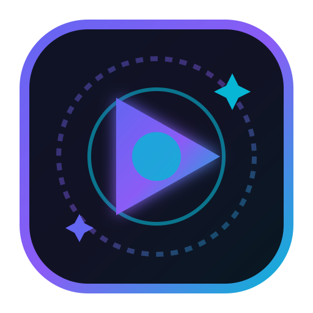

# ⚡ MediaScraper Pro 2.0 — Plataforma de Extracción, Inspección con IA y Curaduría Multimedia

<p align="center">
  
</p>

<p align="center">
  <strong>Plataforma Multiplataforma de Web Scraping, Inspección Visual con Inteligencia Artificial, Edición de Imágenes, Reproductor de Video HD y Exportación de Paquetes en ZIP / PDF.</strong>
</p>

<p align="center">
  <!-- Language & Technology Badges in Image Format -->
  
  
  
  
  
  
  
  
  
  
</p>

---

## 📖 Tabla de Contenidos

1. [Descripción General](#-descripción-general)
2. [Características Principales](#-características-principales)
3. [Lenguajes y Tecnologías (Badges)](#-lenguajes-y-tecnologías)
4. [Arquitectura del Proyecto](#-arquitectura-del-proyecto)
5. [Instalación y Configuración](#-instalación-y-configuración)
6. [Referencia de API Backend](#-referencia-de-api-backend)
7. [Guía de Componentes Frontend](#-guía-de-componentes-frontend)
8. [Licencia](#-licencia)

---

## 🌟 Descripción General

**MediaScraper Pro 2.0** es una suite multiplataforma de grado profesional diseñada para extraer, procesar, analizar, editar y exportar contenido audiovisual (imágenes y videos) desde cualquier sitio web o red social de manera 100% privada, local y escalable.

Desarrollado bajo el paradigma de **Diseño Impeccable 2.0**, combina un motor de scraping backend escalable en Node.js/Express con una interfaz web ultralujosa en **Obsidian Glassmorphic UI**, potentes motores de visión por computadora (**TensorFlow.js** y **Tesseract.js OCR**) y un reproductor de video HTML5 de alto rendimiento estilo YouTube.

---

## 🔥 Características Principales

### 🌐 1. Motor de Scraping Multiplataforma Escalable
- **Compatibilidad Extensa**: Soporta extracción directa en redes sociales y plataformas web (**TikTok, Instagram, YouTube, Pinterest, Twitter/X, Facebook y sitios HTML5 genéricos**).
- **Procesamiento de Fuentes**: Extrae enlaces desde etiquetas ``, `srcset`, `<picture>`, meta tags (`og:image`, `twitter:image`), CSS background-images, etiquetas `<video>`, `<source>`, `.mp4`, `.webm`, `.m3u8` y `.gif`.
- **Filtro Anti-Rastreadores**: Normalización automática de URLs relativas a absolutas y depuración inteligente de píxeles transparentes o rastreadores diminutos (`< 16x16px`).

### 🎨 2. Editor de Imágenes Canvas y Extractor de Paleta HEX
- **Filtros en Tiempo Real**: Escala de grises, Sepia, Alto Contraste, Cyberpunk Neón, Vintage e Inversión.
- **Transformación de Formatos**: Conversión y descarga instantánea a formato **PNG HD** o **JPG comprimido (0.92 quality)**.
- **Extractor de Paleta `#HEX`**: Análisis de densidad de color en tiempo real para generar hasta 5 tonos dominantes formato `#1F2125` con copiado al portapapeles en 1 solo clic (`¡Copiado!`).

### 🔍 3. Panel Lateral de Inspección con IA & Google Lens OCR
- **Clasificación por IA Visual**: Clasificación automática de objetos y etiquetas visuales mediante **TensorFlow.js MobileNet** local.
- **Google Lens OCR**: Reconocimiento óptico de caracteres en imágenes con **Tesseract.js** (soporte multilingüe Español/Inglés).
- **Inspección de Metadatos**: Nombre de archivo, dimensiones en píxeles (`WIDTH x HEIGHT`), formato/extensión y texto alt.

### 🎬 4. Reproductor de Video Personalizado de Ultra-Lujo (Estilo YouTube)
- **Cápsula Flotante Responsiva**: Módulo de controles en 1 sola fila (*Single-Row Dock*) adaptado a cualquier dispositivo o panel lateral.
- **Motor de Calidad Adaptativa Estilo YouTube**:
  - Micro-pausa de amortiguación de 450 ms (`Optimizando flujo a 1080p HD...`).
  - Renderizado dinámico de fidelidad óptica (`1080p HD`, `720p HD`, `480p SD`, `360p SD`).
  - Menú con marcas de verificación activas (`1080p HD ✓`).
- **Controles Avanzados**:
  - ⏯️ Play / Pausa / Replay automático.
  - 🎚️ Barra de tiempo neón con previsualización de fotograma en hover.
  - 🔊 Slider de volumen expandible en hover.
  - 🎵 **Extractor de Audio a MP3** dedicado.
  - 🖼️ Modo Ventana Flotante (Picture-in-Picture).
  - ⛶ Pantalla Completa Nativa Multiplataforma.
- **Auto-Ocultado Inteligente**: Temporizador de inactividad de **6 segundos exactos** (`6000ms`) con suave animación de deslizamiento `cubic-bezier`.

### 📦 5. Exportación Compresiva ZIP y Catálogo Ejecutivo PDF
- **Compresión ZIP en Vivo**: Flujo de transmisión en tiempo real (*Streaming ZIP*) con barra de progreso dinamizada (`0.0 MB/s` a `100%`) y detección automática de descarga completada o cancelada.
- **Catálogo PDF de 4 Elementos por Hoja**: Generación de catálogo corporativo HD ordenado en **grilla 2x2 sin cortes a mitad de página**, conservando el tema oscuro, logos y metadata (`MediaScraper_Catalogo_XXXXXXXX.pdf`).

---

## 🛠️ Lenguajes y Tecnologías

### Lenguajes y Runtimes
| Tecnología | Insignia | Descripción |
| :--- | :---: | :--- |
| **Node.js** |  | Runtime de ejecución backend escalable. |
| **JavaScript** |  | Lenguaje principal (Lógica Vanilla ES6+ sin bundlers). |
| **HTML5** |  | Estructura semántica, modales y etiquetas multimedia. |
| **CSS3** |  | Sistema de diseño Impeccable Obsidian Glass. |

### Dependencias y Motores Backend / Frontend
| Librería / Motor | Insignia | Uso Principal |
| :--- | :---: | :--- |
| **Express.js** |  | Framework de rutas API HTTP y Proxy de medios. |
| **TensorFlow.js** |  | Modelo de Inteligencia Artificial para visión por computadora. |
| **Tesseract.js** |  | Motor OCR para extracción de texto en imágenes. |
| **Archiver** |  | Compresión streaming de paquetes de archivos. |
| **html2pdf.js** |  | Generación de catálogo de reportes PDF en grilla 2x2. |
| **PWA Engine** |  | Instalabilidad nativa en SO y caché offline. |

---

## 📁 Arquitectura del Proyecto

```
MediaScraper/
├── server.js                      # Servidor Express, endpoints API, Scraping Proxy y ZIP Streamer
├── package.json                   # Manifiesto de dependencias y scripts Node.js
├── README.md                      # Documentación exhaustiva del proyecto
└── public/                        # Directorio de activos públicos servidos por Express
    ├── index.html                 # Estructura principal HTML5 y contenedores modales
    ├── manifest.json              # Manifiesto PWA para instalación en SO
    ├── sw.js                      # Service Worker para almacenamiento en caché offline
    ├── css/
    │   ├── main.css               # Tokens de diseño, tipografía y diseño global
    │   ├── components.css         # Estilos de tarjetas 3D, banners y paneles
    │   └── videoPlayer.css        # Estilos del reproductor, dock flotante, modales y filtros
    ├── js/
    │   ├── app.js                 # Controlador principal y gestión de eventos de scraping
    │   ├── components/
    │   │   ├── drawer.component.js      # Panel lateral de inspección con IA & OCR
    │   │   ├── fullscreen.component.js  # Visor panorámico en HD con zoom 3D
    │   │   ├── imageEditor.component.js # Editor canvas y extractor paleta HEX
    │   │   └── videoPlayer.component.js # Reproductor de video personalizado de 1 fila
    │   └── services/
    │       ├── aiVision.service.js      # Servicio de etiquetado por IA TensorFlow.js
    │       └── pdfReport.service.js     # Servicio de catálogo PDF en grilla 2x2
    └── assets/
        └── logo.svg               # Logotipo oficial vectorizado de MediaScraper
```

---

## 🚀 Instalación y Configuración

### Requisitos Previos
- **Node.js** v18.0.0 o superior.
- Navegador moderno con soporte para WebGL y WebAssembly (Chrome, Edge, Firefox, Safari).

### Pasos de Inicio Rápido

1. **Clonar el repositorio o navegar al directorio del proyecto**:
   ```bash
   cd C:\Users\USUARIO\Desktop\MediaScraper
   ```

2. **Instalar dependencias**:
   ```bash
   npm install
   ```

3. **Iniciar el servidor local**:
   ```bash
   npm start
   ```

4. **Acceder a la aplicación**:
   Abre tu navegador e ingresa a: `http://localhost:3000`

---

## 📡 Referencia de API Backend

### 1. `POST /api/scrape`
Analiza una URL remota y extrae todas las imágenes y videos accesibles.
- **Body**: `{ "url": "https://ejemplo.com" }`
- **Respuesta JSON**:
  ```json
  {
    "success": true,
    "url": "https://ejemplo.com",
    "title": "Título de la página",
    "totalCount": 12,
    "media": [
      {
        "id": "media-1",
        "url": "https://ejemplo.com/imagen.jpg",
        "proxyUrl": "/api/proxy-media?url=...",
        "type": "image",
        "extension": "jpg",
        "filename": "imagen.jpg"
      }
    ]
  }
  ```

### 2. `GET /api/proxy-media`
Proxy seguro para eludir restricciones de CORS y servir medios de forma local.
- **Query Params**: `?url=https://...`

### 3. `POST /api/download-zip`
Empaqueta y transmite múltiples archivos seleccionados en un archivo ZIP.
- **Body**: `{ "urls": ["https://..."], "packageName": "MediaScraper_Paquete.zip" }`

### 4. `GET /api/download`
Fuerza la descarga individual de un archivo con encabezados `Content-Disposition`.
- **Query Params**: `?url=https://...&filename=nombre.ext`

---

## 📄 Licencia

Este proyecto está bajo la Licencia **MIT**. Consulta el archivo `LICENSE` para más detalles.

---

<p align="center">
  Desarrollado con ❤️ y la ingeniería de <strong>MediaScraper Team — 2026</strong>
</p>
